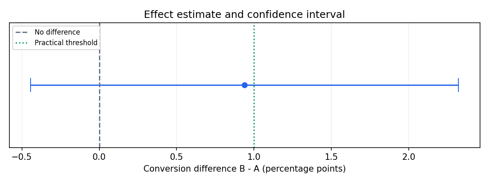

# A/B-эксперимент: анализ конверсии

**Учебная симуляция. Данные не являются результатом реального продуктового эксперимента.**

| Группа | Пользователи | Конверсии | Конверсия |
|---|---:|---:|---:|
| A | 3835 | 390 | 10.17% |
| B | 3835 | 426 | 11.11% |

Разница B − A: **+0.94 п.п.** Относительный uplift: **+9.23%**.
95% доверительный интервал разницы: **[-0.44; +2.32] п.п.** Метод: Newcombe.
Двусторонний тест: Pooled two-proportion z-test; p-value = **0.182479**, α = 0.05.

Практический порог: +1.00 п.п. Он отличается по смыслу от MDE для планирования мощности.
SRM: p-value = 1, порог проверки = 0.001; флаг дисбаланса: False.

**Интерпретация:** Недостаточно оснований отвергнуть равенство конверсий. Это не доказывает отсутствие эффекта.

План: baseline 10.0%, MDE +2.0 п.п., мощность 80%, по 3835 пользователей на группу. Выборка набрана: True.
Оценка набора: 8 дней; с округлением до полных недель — 14. После последнего включённого пользователя нужно дождаться 7-дневного окна конверсии.

## Monte Carlo

| Сценарий | Частота отклонения H0 | Стандартная ошибка Monte Carlo |
|---|---:|---:|
| null | 4.90% | 0.0068 |
| alternative | 81.40% | 0.0123 |

Это частоты в повторных симуляциях, а не «наблюдаемая мощность» единственного теста.

## Допущения и ограничения

- Один независимый пользователь — одна строка; экспериментальная единица и единица анализа совпадают.
- Одна основная бинарная метрика, две группы, один заранее выбранный финальный анализ.
- Нет подглядывания, досрочной остановки, перебора сегментов и выбора удачного seed.
- Окно конверсии одинаковое, неполные наблюдения не исключаются после знакомства с результатом.
- Статистическая значимость не гарантирует бизнес-ценность и не является вероятностью истинности H0.
- MDE — эффект, для которого планируется заданная мощность; это не минимальная наблюдаемая разница и не обязательный бизнес-порог.
- CI Newcombe и выбранный тест не являются точными взаимными обращениями; возле границы значимости возможны небольшие расхождения.
- Корректировки на множественные сравнения, кластеризацию, CUPED и последовательный анализ не реализованы.

